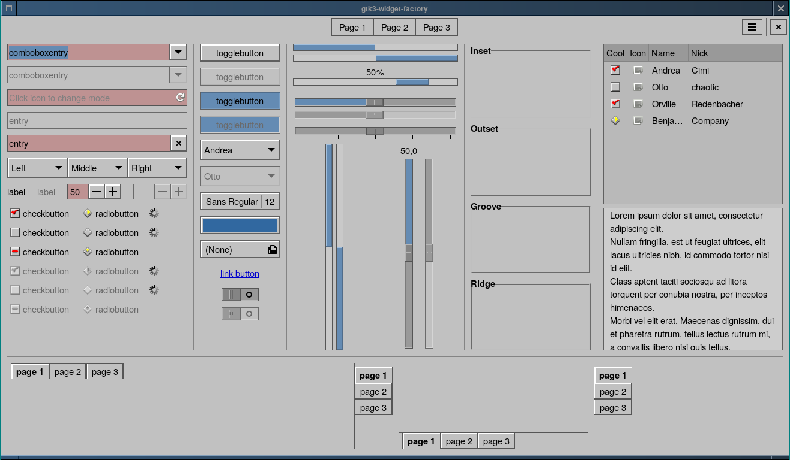

# irixium-gtk-theme

[Irixium](https://github.com/Pyanyaleri/Irixium) by Pyanyaleri is an SGI
IRIX-inspired GTK3 theme with grey bevels, blue selections and dusty-rose
entries. This repo packages it, unmodified, as a Nix flake.


<p align="center"><sub><code>gtk3-widget-factory</code> with Irixium, in Hyprland with
<a href="https://github.com/Gustlik501/hypr-wmdeco">hypr-wmdeco</a> titlebars. Font: TeX Gyre Heros 10.</sub></p>

> [!NOTE]
> **GTK3 only.** Upstream's README mentions GTK4, but the theme ships only
> `gtk-3.0/`, so libadwaita and GTK4 apps keep their default look.

> [!IMPORTANT]
> The theme's **images are CC-BY-NC-SA-4.0**: noncommercial use only, with
> attribution and share-alike. The CSS is GPL-3.0. Because of the image
> license, the package is marked **unfree**, and you have to allow it
> explicitly (see below).

## Install

```nix
# flake.nix
inputs.irixium-gtk-theme = {
  url = "github:Gustlik501/irixium-gtk-theme";
  inputs.nixpkgs.follows = "nixpkgs";
};

nixpkgs.overlays = [ inputs.irixium-gtk-theme.overlays.default ];  # pkgs.irixium-gtk-theme
nixpkgs.config.allowUnfreePredicate = pkg:
  builtins.elem (lib.getName pkg) [ "irixium-gtk-theme" ];
```

Home Manager:

```nix
gtk = {
  enable = true;
  theme = { package = pkgs.irixium-gtk-theme; name = "Irixium"; };
  font  = { package = pkgs.tex-gyre.heros; name = "TeX Gyre Heros"; size = 10; };  # optional, Helvetica-like
};
```

To try it on a single app without installing anything:

```sh
p=$(nix build --no-link --print-out-paths github:Gustlik501/irixium-gtk-theme)
XDG_DATA_DIRS=$p/share:$XDG_DATA_DIRS GTK_THEME=Irixium gtk3-widget-factory
```

The theme name `Irixium` is case-sensitive. The flake's own `packages` output
already allows this one unfree package, so `nix build` works without extra
configuration. Only overlay users need the predicate above.

## What gets installed

- `share/themes/Irixium/index.theme`
- `share/themes/Irixium/gtk-3.0/{gtk.css,assets/}`
- `share/doc/irixium-gtk-theme/{LICENSE,upstream-README.md}`

The theme is pinned to upstream main
`ca46817bb2fe652ba73ba8e4c2b35a6827d9e091` (2022-05-22) and fetched at build
time. Nothing from the theme is committed to this repo.

<details>
<summary><b>Verification</b></summary>

```sh
nix build
nix flake check
nix develop --command python verify.py
```

`verify.py` launches its own Xvfb and private D-Bus session, with throwaway
HOME and XDG directories. It runs `gtk3-widget-factory` and Thunar under the
theme, captures both windows, and checks for GTK CSS warnings; there are none.
The screenshot above comes from a separate private, offscreen Hyprland instance
running on Wayland.

</details>

## License

The upstream theme's CSS is **GPL-3.0**, and its images, including those
visible in the screenshot, are **CC-BY-NC-SA-4.0**, © Pyanyaleri. Do not
treat the images as GPL or as commercially redistributable.

---

Part of a small retro-desktop set for Hyprland:
[hypr-wmdeco](https://github.com/Gustlik501/hypr-wmdeco) ·
**irixium-gtk-theme** ·
[chicago95-cursors](https://github.com/Gustlik501/chicago95-cursors) ·
[misc-fixed-ttf](https://github.com/Gustlik501/misc-fixed-ttf) ·
[nextlike-icons](https://github.com/Gustlik501/nextlike-icons)
